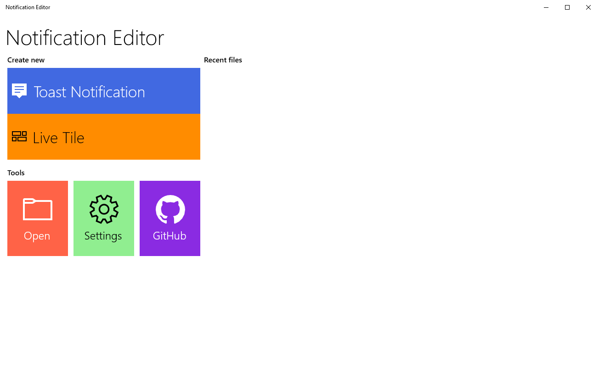
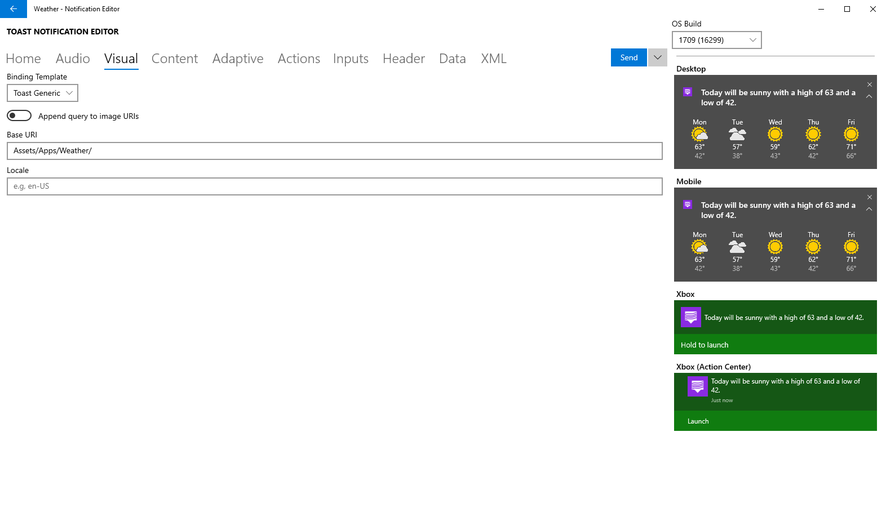
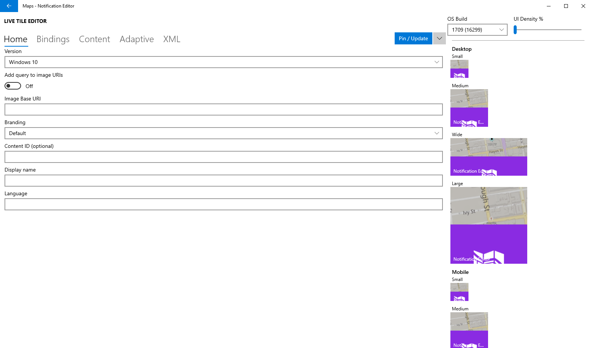

<h1>
  
  Notification Editor
</h1>
After 4 months, it's finally here! A schema-compliant, UWP-based Windows notification editor that supports live tiles and Adaptive, compatible down to Windows 10 1507!
<br><br>

 


Notification Editor is the sequel to my old project, [Notification Designer](FireBlade211/Notification-Designer).

## Compatibility
**Notification Editor** is fully compatible down to Windows 10, version 1507 (a.k.a the first RTM release of Windows 10).

## Features
|Feature|Notification Editor|Notification Designer|Notes|
|:-------|:---------------------:|:--------------------:|:------|
|Editing toast notifications|✅|✅| - |
|Editing live tiles|✅|❌| - |
|Supports full notification schema|✅|❌| - |
|Backwards compatible|✅|❌|**Notification Editor** is built on UWP and is backwards-compatible all the way back to Windows 10, version 1507|
|Polished|✅|❌|**Notification Editor** is overall more polished than **Notification Designer**, with a home page containing an MRU (Most Recently Used) list.|
|Supports file import|✅|❌|**Notification Editor** can import existing notification payloads into the editor.|
|Includes notification preview|✅|❌| - |
|Supports NotificationData (toasts)|✅|❌|Notification data can be used to bind to data on toast notifications. For more info, see the **Data** tab in the *Toast Notification Editor*.|
|Allows manually editing XML|✅|❌|While the main point of both **Notification Editor** and **Notification Designer** is visually editing toasts, **Notification Editor** allows you to manually edit the XML if you want to.|

## Build Notification Editor
Sadly I can't give you can easy to install **MSIX** package, because Windows requires the certificate used to be trusted, not self-signed. Because of this, you have to build **Notification Editor** yourself:

1. Clone the repository.
```pwsh
git clone https://github.com/FireBlade211/Notification-Editor.git
```
2. Open the `Notification Editor.sln` file (under the `src` folder) in **Visual Studio**.
3. Click `Build` -\> `Build Solution`.
